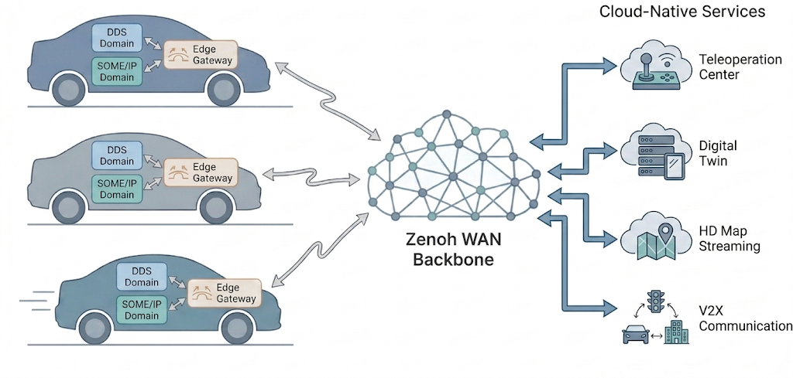

<div align="center">

# Multi-Protocol Gateway for Software-Defined Vehicles

[](https://isocpp.org/)
[](https://ubuntu.com/)
[](LICENSE)
[](https://doi.org/10.1109/ACCESS.2026.3739371)

A cloud-extended multi-protocol gateway that bridges **SOME/IP**, **DDS**, and **Zenoh** for autonomous driving and robotics applications. Enables seamless interoperability between legacy automotive in-vehicle networks and modern cloud-native middleware.



</div>

> **Paper**: S. Lee, H. Choi, and C. Moon, "A Cloud-Extended Multiprotocol Gateway for Software-Defined Vehicles: Bridging SOME/IP, DDS, and Zenoh," *IEEE Access*, vol. 14, pp. 155905–155921, 2026, doi: [10.1109/ACCESS.2026.3739371](https://doi.org/10.1109/ACCESS.2026.3739371). (Open Access)

## Motivation

Modern software-defined vehicles (SDVs) rely on heterogeneous communication protocols: **SOME/IP** for in-vehicle service-oriented communication, **DDS** for real-time robotics middleware (ROS 2), and **Zenoh** for lightweight WAN/cloud connectivity. However, no unified gateway exists to bridge all three protocols while supporting cloud-native services such as teleoperation, digital twins, and HD map streaming.

## Key Features

- **Multi-Protocol Bridging** — Bidirectional translation across all 6 protocol combinations (DDS <-> SOME/IP <-> Zenoh)
- **Cloud-Native Scalability** — Zenoh WAN backbone for teleoperation, digital twin, and data offloading
- **Dynamic Discovery** — Automatic bridge creation/deletion based on endpoint availability
- **ROS 2 Compatible** — Native support for ROS 2 message types via Fast DDS
- **Reference-Counted Resources** — Efficient sharing of DDS topics, SOME/IP services, and Zenoh keys
- **Isolated Build System** — All dependencies built locally under `~/ws/install`

## Architecture

`GatewayCore` is the central orchestrator. It manages six protocol handlers (one Source and one Sink per protocol), a `DiscoveryManager` for automatic bridge lifecycle, and the shared per-connection asynchronous queue that decouples Source receive from Sink publish. See the paper's §3 for the full internal breakdown.

## Getting Started

<details>
<summary><strong>Prerequisites</strong> (click to expand)</summary>

| Dependency | Version |
|-----------|---------|
| Ubuntu | 24.04 |
| GCC | 13.3.0 |
| Fast DDS | v2.14.5 |
| Fast CDR | v2.2.5 |
| Fast-DDS-Gen | v3.3.1 (Java 17) |
| vSomeIP | v3.5.8 (Boost 1.83) |
| Zenoh C/C++ | v1.8.0 (Rust/Cargo) |
| spdlog | v1.12.0 |

For detailed installation instructions, see [`docs/installation.md`](docs/installation.md).

</details>

### Build & Run

```bash
# Environment setup (required before ALL operations)
source ~/ws/setup.sh

# 1. Generate Fast DDS sources from the enabled ROS 2 IDLs
~/ws/src/multi-protocol-gateway/ros2/scripts/build_from_idls.sh

# 2. Regenerate the type registry + converter to match ros2_msg_config.h
~/ws/src/multi-protocol-gateway/ros2/scripts/update_with_config.sh

# 3. Build the gateway
rm -rf ~/ws/build/gateway && mkdir -p ~/ws/build/gateway
cmake -B ~/ws/build/gateway -S ~/ws/src/multi-protocol-gateway && make -C ~/ws/build/gateway -j$(nproc)

# 4. (optional) Build the examples (gateway_demo binary)
rm -rf ~/ws/build/examples && mkdir -p ~/ws/build/examples
cmake -B ~/ws/build/examples -S ~/ws/src/multi-protocol-gateway/examples && make -C ~/ws/build/examples -j$(nproc)

# 5. Run the gateway — all config paths come from env vars
export GATEWAY_MAPPING_PATH=<absolute path to mappings.json>
export ZENOH_CONFIG_PATH=<absolute path to zenoh.json5>
# Only required if the mapping uses any SOMEIP source/sink:
export VSOMEIP_CONFIG_PATH=<absolute path to vsomeip.json>
export VSOMEIP_APP_NAME=gateway_app

~/ws/build/gateway/multi_protocol_gateway
```

The mapping JSON declares which (source, sink, message_type, qos) bridges the
gateway is willing to create when both endpoints are discovered. See
[`examples/mappings/`](examples/mappings/) for ready-to-use mapping files
(all 6 directions plus an `all_directions.json` aggregate), and
[`examples/README.md`](examples/README.md) for a two-terminal demo walkthrough.

## Project Structure

```
multi-protocol-gateway/
├── src/                             # Gateway core
│   ├── main.cpp                     # Entry: reads GATEWAY_MAPPING_PATH env, runs idle
│   ├── gateway/gateway_core.*       # Central orchestrator
│   ├── dds/, someip/, zenoh/        # Per-protocol pub/sub handlers
│   ├── discovery/                   # Auto bridge lifecycle management
│   └── common/                      # Command, queue, logger, bench_util header
├── ros2/msgs/                       # ROS 2 IDL types (user-configurable)
├── third_party/                     # Vendored libraries
│   ├── spdlog/                      # (git submodule, v1.12.0)
│   └── json/json.hpp                # nlohmann/json
├── examples/                        # Standalone demo + ready-to-use configs
│   ├── CMakeLists.txt               # Builds gateway_demo binary
│   ├── src/                         # demo.cpp + ext_nodes wrappers
│   ├── mappings/                    # Mapping JSONs (all 6 directions)
│   └── configs/                     # vsomeip + zenoh configs (gateway_*, demo_*)
├── docs/
│   └── installation.md              # Dependency setup guide
└── CMakeLists.txt
```

## Citation

If you use this work, please cite:

```bibtex
@article{lee2026gateway,
  title     = {A Cloud-Extended Multiprotocol Gateway for Software-Defined Vehicles: Bridging SOME/IP, DDS, and Zenoh},
  author    = {Lee, Suhaeng and Choi, Hyeongju and Moon, Changjoo},
  journal   = {IEEE Access},
  volume    = {14},
  pages     = {155905--155921},
  year      = {2026},
  publisher = {IEEE},
  doi       = {10.1109/ACCESS.2026.3739371}
}
```

## License

This project is licensed under the [MIT License](LICENSE).
